# C-MAKER ERD (개체-관계 다이어그램)

- **버전**: v1.5.0
- **작성일**: 2026-08-26 (최종 수정: 2026-10-14)

---

## 변경 이력

| 버전 | 날짜 | 내용 |
|---|---|---|
| v1.0.0 | 2026-08-26 | 초안 작성 |
| v1.1.0 | 2026-09-08 | 문서 정합성 점검 결과 반영: (1) `1-domain-definition.md` v1.1.0에 추가된 USER 세션 정책·표시 개인화 설정을 `USER` 테이블 컬럼으로 반영(§0 전제 문구 조정 포함). (2) `USER.role`을 `본부(마케팅)`/`본부(준법)` 구분이 가능하도록 확장하고 CONST-03·CONST-11을 갱신 |
| v1.1.1 | 2026-09-08 | 큰글 모드(표시 개인화) 기능 제외 결정에 따라 `USER.display_preferences` 컬럼과 관련 설명을 제거. 세션 정책 컬럼(`session_timeout_minutes`, `session_extendable`)은 유지 |
| v1.2.0 | 2026-09-08 | `report/CHANGE-REQUEST_v1.md` CHG-08 반영: `BUSINESS`에 모집단 적재 컬럼(`permit_mgt_no`, `source_crs`, `status_source`, `licensed_on`, `population_as_of`) 추가, 좌표를 WGS84 전제로 명시(VAL-11), `biz_reg_no` NULL 허용. `SIGNAL.scope`, `RECOMMENDATION.freshness_score`/`reason_tier` 추가. CONST-13~15 신설. `is_exploration_slot` 설명에 "1~20위 내 포함, 21~23위 아님"을 명시해 기존 불일치(부록 A)를 해소 |
| v1.3.0 | 2026-09-08 | 배치 수동 재실행(REQ-17, UC-18) 반영: `BATCH_RUN` 엔티티 신설(`run_type`, `status`, `triggered_by`, `requested_at`/`started_at`/`completed_at`, `failure_reason`), `USER 1:N BATCH_RUN` 관계 추가. CONST-16~18 신설(권한 제한, 중복 실행 방지, 쿨다운) |
| v1.4.0 | 2026-09-08 | `report/db-schema-decisions-review.md` 검토 결과 반영: (1) `USER.password_hash` → `password`로 변경(평문 저장, 해싱 미적용). (2) `BRANCH_HISTORY` 엔티티 신설 + `BRANCH 1:N BRANCH_HISTORY` 관계 추가 — RULE-BRANCH-01(익일 반영)을 이력 테이블+`effective_from` 트리거로 구현. (3) `BRANCH.lat/lng`를 nullable로 명시하고 별도 지오코딩 배치(10분 주기)가 채움을 주석에 반영, VAL-03 관련 저장 시점 검증 제거. (4) CONST-19 신설(BRANCH 변경 이력 트리거), CONST-20 신설(BATCH_RUN 외 여러 행 집계 제약은 DB CHECK 대상이 아님을 명시). branch_code 형식 제약(6자리 숫자)을 CONST-01 설명에 반영 |
| v1.5.0 | 2026-10-14 | 구현 스키마(`backend/database/schema.sql`·`seed.sql`·`patches/2026-10-13_forecast_signals.sql`)와 정합화: (1) §0에 전용 스키마 `cmaker`, `USER`→`app_user` 테이블명, Phase 2·3 테이블 미생성 명시. (2) ERD 엔티티를 실제 컬럼으로 보강(감사 추적·병합키·운영 파라미터 컬럼 등), 시각 컬럼을 TIMESTAMPTZ로, `AUDIT_LOG` 엔티티와 `BATCH_RUN`→`EVENT`/`SIGNAL`/`RECOMMENDATION` 관계 추가. (3) §2 컬럼 설명 정정·추가(`permit_mgt_no` VARCHAR(40) NULL 허용, `status_source` SBIZ 추가, `run_type` 실제 cron 시각, `reject_reason` 코드값, `THRESHOLD_CONFIG.category`/SYSTEM 파라미터 등). (4) §4 CONST-04·05·07·13·15·16·17·18·19 정정. (5) §5 인덱스·트리거, §6 초기 데이터 절 신설 |

---

## 0. 문서 목적 및 전제

본 문서는 `1-domain-definition.md`(v1.4.0) 3장에 정의된 엔티티와 도메인 규칙을, `2-prd.md`(v1.4.0) 5장의 PostgreSQL 17 · ORM 미사용(직접 SQL) 제약과 `4-project-principle.md`(v1.5.0) 6장의 `database/schema.sql` 단일 파일 스키마 컨벤션에 맞춰 ERD로 표현한다. 세션 토큰·알림 이력처럼 도메인 정의서에 없는 개념의 전용 테이블은 추가하지 않되, 도메인 정의서가 특정 엔티티의 속성으로 명시한 값(예: USER의 세션 정책, BUSINESS의 모집단 적재 속성, 배치 실행 이력, BRANCH의 변경 이력)은 해당 엔티티 테이블의 컬럼으로 반영한다. 예외로 REQ-15 감사 추적(태깅·임계치 변경·배치 재실행·CRM 다운로드 이력)을 위해 `AUDIT_LOG`를 둔다.

구현 스키마의 진실의 원천은 `backend/database/schema.sql`(구조), `backend/database/seed.sql`(초기 데이터), `backend/database/patches/`(기존 설치 보정)이다. 구현상 전제는 다음과 같다.

- **전용 스키마 `cmaker` 사용**: 공유 DB(`myapp_db`)의 기존 테이블과 이름 충돌을 막기 위해 모든 테이블·함수·트리거는 `cmaker` 스키마에 생성한다(`CREATE SCHEMA IF NOT EXISTS cmaker; SET search_path TO cmaker;`).
- **`USER` 엔티티의 실제 테이블명은 `app_user`**: PostgreSQL 예약어(`USER`) 회피. 로그인 아이디 컬럼 `username`(UNIQUE)이 추가되어 있다. 본 문서는 도메인 용어에 맞춰 엔티티명을 `USER`로 표기한다.
- **타입 표기**: 시각 컬럼은 모두 `TIMESTAMPTZ`로 저장하고, 업무 기준 시각(익일 07:30 등)은 `Asia/Seoul`로 계산한다. 본 문서의 `DECIMAL`은 `schema.sql`의 `NUMERIC`과 같다.

`report/db-schema-decisions-review.md`에서 결정된 대로, USER·BRANCH는 전용 등록/수정 화면·API 없이 운영자가 psql로 직접 INSERT/UPDATE한다(REQ-01 재정의, UC-01·UC-02·API-01 MVP 스코프 제외). 이 결정은 스키마 형태(컬럼·제약)에는 영향을 주지만, ERD 자체는 화면 유무와 무관하게 최종 스키마를 표현한다.

Phase 2·3 전용 엔티티(`OPERATION_FORECAST`, `CAMPAIGN`, `CAMPAIGN_TARGET_BRANCH`, `CAMPAIGN_DRAFT`, `APPROVAL_LOG`)는 **설계로만 표기하며, MVP `schema.sql`에는 생성하지 않는다**(`7-execution-plan.md` 단계별 계획).

---

## 1. ERD

```mermaid
erDiagram
    %% USER 엔티티의 실제 테이블명은 app_user (PostgreSQL 예약어 회피), 모든 테이블은 cmaker 스키마
    %% OPERATION_FORECAST, CAMPAIGN 계열은 Phase 2·3 설계 전용(MVP schema.sql 미생성)
    BRANCH ||--o{ USER : "소속시킨다"
    BRANCH ||--o{ BRANCH_HISTORY : "변경 이력을 가진다"
    BRANCH ||--o{ SIGNAL : "감지한다"
    BRANCH ||--o{ EVENT : "발생시킨다"
    BRANCH ||--o{ RECOMMENDATION : "받는다"
    BRANCH ||--o{ OPERATION_FORECAST : "받는다"
    BRANCH ||--o{ CAMPAIGN_TARGET_BRANCH : "대상이 된다"

    DATA_SOURCE_SNAPSHOT ||--o{ SIGNAL : "근거가 된다"
    SIGNAL }o--o| EVENT : "승격된다"
    EVENT ||--o{ RECOMMENDATION_EVENT : "사유로 인용된다"
    RECOMMENDATION ||--o{ RECOMMENDATION_EVENT : "근거 신호를 가진다"
    RECOMMENDATION ||--o| BRIEF : "생성한다"
    RECOMMENDATION ||--o| TAG_FEEDBACK : "태깅된다"
    BUSINESS ||--o{ RECOMMENDATION : "추천 대상이 된다"
    BUSINESS |o--o{ SIGNAL : "사업체 단위 신호를 가진다"

    BATCH_RUN |o--o{ SIGNAL : "생성한다"
    BATCH_RUN |o--o{ EVENT : "생성한다"
    BATCH_RUN |o--o{ RECOMMENDATION : "생성한다"

    USER ||--o{ TAG_FEEDBACK : "태깅한다"
    USER ||--o{ THRESHOLD_CONFIG : "수정한다"
    USER ||--o{ APPROVAL_LOG : "승인한다"
    USER ||--o{ BATCH_RUN : "수동 재실행을 요청한다"
    USER |o--o{ AUDIT_LOG : "행위자로 기록된다"

    CAMPAIGN ||--o{ CAMPAIGN_DRAFT : "초안을 가진다"
    CAMPAIGN ||--o{ APPROVAL_LOG : "승인 이력을 가진다"
    CAMPAIGN ||--o{ CAMPAIGN_TARGET_BRANCH : "대상 지점을 가진다"
    EVENT ||--o| CAMPAIGN : "트리거한다"

    BRANCH {
        SERIAL id PK
        VARCHAR branch_code "UNIQUE, 숫자 6자리, VAL-01"
        VARCHAR name
        VARCHAR address
        DECIMAL lat "nullable, 별도 지오코딩 배치가 채움(RULE-BRANCH-03), VAL-03 폐기"
        DECIMAL lng "nullable, 별도 지오코딩 배치가 채움(RULE-BRANCH-03), VAL-03 폐기"
        VARCHAR geocoded_address "nullable, 좌표를 산출한 주소(주소 변경 감지용)"
        DECIMAL coverage_radius_km "VAL-02"
        VARCHAR primary_industry_tags "쉼표 구분 주력 업종 키워드, 기본 ''"
        BOOLEAN handles_forex "기본 FALSE"
        INT atm_count "0 이상, 기본 0"
        TIMESTAMPTZ effective_from "RULE-BRANCH-01, INSERT/UPDATE 트리거가 자동 설정(CONST-19)"
        TIMESTAMPTZ created_at
        TIMESTAMPTZ updated_at
    }

    BRANCH_HISTORY {
        SERIAL id PK
        INT branch_id FK
        VARCHAR name
        VARCHAR address
        DECIMAL lat
        DECIMAL lng
        DECIMAL coverage_radius_km
        VARCHAR primary_industry_tags
        BOOLEAN handles_forex
        INT atm_count
        TIMESTAMPTZ valid_from "변경 전 BRANCH.effective_from"
        TIMESTAMPTZ valid_until "이 스냅샷이 유효했던 종료 시각 = 다음 값의 BRANCH.effective_from"
        TIMESTAMPTZ recorded_at "이력 기록 시각"
    }

    USER {
        SERIAL id PK
        INT branch_id FK "본부는 NULL, VAL-08"
        VARCHAR username "UNIQUE, 로그인 아이디"
        VARCHAR name
        VARCHAR role "RM/BRANCH_MANAGER/HQ_MARKETING/HQ_COMPLIANCE, VAL-08"
        VARCHAR password "평문 저장, 해싱 미적용(운영자 psql 직접 INSERT)"
        INT session_timeout_minutes "비활동 시 자동 로그아웃(분), 기본 30, 5~480"
        BOOLEAN session_extendable "세션 연장 가능 여부, 기본 TRUE"
        BOOLEAN is_active "기본 TRUE, FALSE면 로그인·세션 연장 불가"
        TIMESTAMPTZ created_at
    }

    DATA_SOURCE_SNAPSHOT {
        SERIAL id PK
        VARCHAR source_name
        DATE as_of_date "VAL-09"
        TIMESTAMPTZ fetched_at
        JSONB request_params "요청 파라미터, 기본 {}"
        CHAR payload_hash "원본 SHA-256(64자), (source_name, as_of_date, payload_hash) UNIQUE"
        JSONB raw_payload
    }

    SIGNAL {
        SERIAL id PK
        INT snapshot_id FK
        INT branch_id FK
        INT business_id FK "NULL 허용, 사업체 단위 신호가 아니면 NULL"
        VARCHAR signal_type "사업자/상권/거시환경"
        VARCHAR scope "BUSINESS/INDUSTRY/AREA — 사유 계층, RULE-TARGET-06"
        VARCHAR target_key "동일 대상 판정 키(예: BUSINESS:12, INDUSTRY:한식, AREA)"
        DECIMAL intensity "0~1 정규화"
        DECIMAL raw_value "임계치 비교값(THRESHOLD_CONFIG.unit 단위), CONST-05"
        VARCHAR unit
        JSONB detail "브리프 사실 문장 근거값, 기본 {}"
        DATE as_of_date "VAL-09"
        INT event_id FK "NULL 허용, 승격/병합 시 채워짐"
        INT batch_run_id FK "NULL 허용"
        TIMESTAMPTZ created_at
    }

    EVENT {
        SERIAL id PK
        INT branch_id FK
        VARCHAR signal_type
        VARCHAR scope "BUSINESS/INDUSTRY/AREA"
        VARCHAR target_key "동일 대상 판정 키"
        TEXT promotion_reason
        DATE occurred_on
        DATE as_of_date "VAL-09 소스 기준일"
        DATE last_merged_on "NULL 허용, 쿨다운 내 재발로 병합된 최근 일자(RULE-SENSE-01)"
        DECIMAL score "기본 0, 상한 절사 순서(RULE-SENSE-02)"
        VARCHAR status "ACTIVE/MERGED/TRIMMED"
        INT batch_run_id FK "NULL 허용"
        TIMESTAMPTZ created_at
    }

    BUSINESS {
        SERIAL id PK
        VARCHAR permit_mgt_no "UNIQUE, NULL 허용, 인허가 관리번호 = 병합 기준키, CONST-13"
        VARCHAR sbiz_store_id "UNIQUE, NULL 허용, 소진공 상가업소번호 = 병합 기준키, CONST-13"
        VARCHAR name
        VARCHAR industry_code "기본 ''"
        VARCHAR industry_name "기본 ''"
        VARCHAR address "NULL 허용"
        DECIMAL lat "WGS84, VAL-11"
        DECIMAL lng "WGS84, VAL-11"
        VARCHAR source_crs "원본 좌표계 코드 (예: EPSG:5174), VAL-11"
        VARCHAR biz_reg_no "VAL-04, NULL 허용 — 표준 인허가 데이터 미제공"
        VARCHAR operating_status "정상/휴업/폐업/영업정지"
        VARCHAR status_source "PERMIT/SBIZ/NTS, CONST-15"
        DATE licensed_on "인허가일자 — 신선도 항 R 계산용, RULE-TARGET-05"
        DATE status_checked_at
        DATE population_as_of "모집단 적재 기준월, REQ-16"
        TIMESTAMPTZ created_at
        TIMESTAMPTZ updated_at
    }

    RECOMMENDATION {
        SERIAL id PK
        INT branch_id FK
        INT business_id FK
        DECIMAL score
        DECIMAL signal_score "Σ wᵢ·sᵢ"
        DECIMAL freshness_score "신선도 항 R, RULE-TARGET-05"
        DECIMAL proximity "근접도"
        DECIMAL scale_fit "규모적합도"
        DECIMAL distance_km "지점~사업체 거리"
        VARCHAR reason_tier "BUSINESS/INDUSTRY/AREA, RULE-TARGET-06"
        INT rank_in_branch "1~20"
        BOOLEAN is_exploration_slot "RULE-TARGET-03/04"
        DATE recommended_on
        INT batch_run_id FK "NULL 허용"
        JSONB score_detail "신호별 기여·가중치(감사 추적), 기본 {}"
        TIMESTAMPTZ created_at
    }

    RECOMMENDATION_EVENT {
        INT recommendation_id FK
        INT event_id FK
    }

    BRIEF {
        SERIAL id PK
        INT recommendation_id FK "UNIQUE"
        TEXT reason_summary
        JSONB reason_facts "[{text, sourceTag}], 기본 []"
        TEXT talk_script "줄 단위, 최대 3문장"
        TEXT checklist "줄 단위"
        JSONB citation_tags "RULE-BRIEF-01"
        VARCHAR generation_status "LLM/TEMPLATE/REASON_ONLY, RULE-BRIEF-02"
        JSONB validation_errors "기본 []"
        TEXT prompt "NULL 허용, 감사 추적"
        VARCHAR model_version "NULL 허용"
        TEXT raw_output "NULL 허용"
        INT latency_ms "NULL 허용"
        TIMESTAMPTZ generated_at
    }

    TAG_FEEDBACK {
        SERIAL id PK
        INT recommendation_id FK "UNIQUE"
        INT tagged_by FK
        VARCHAR tag_value "VISITED/HOLD/REJECTED"
        VARCHAR reject_reason "ALREADY_CUSTOMER/NOT_TARGET/INFO_ERROR/UNREACHABLE, VAL-06"
        TIMESTAMPTZ tagged_at
    }

    SIGNAL_WEIGHT {
        SERIAL id PK
        VARCHAR signal_type
        VARCHAR industry_code "기본 '*' = 신호 전체(상위 계층, RULE-LEARN-03)"
        DECIMAL weight "VAL-10, 0.2~2.0"
        DECIMAL base_weight "w₀ 룰 기반 초기 가중치, 0.2~2.0"
        DECIMAL alpha
        DECIMAL beta
        INT sample_count
        TIMESTAMPTZ updated_at
    }

    THRESHOLD_CONFIG {
        SERIAL id PK
        VARCHAR signal_type "UNIQUE, 신호종류 또는 운영 파라미터 코드"
        VARCHAR category "SIGNAL/SYSTEM"
        VARCHAR label
        TEXT description
        DECIMAL threshold_value "VAL-05"
        VARCHAR unit
        BOOLEAN is_fixed "UI에서 변경 불가"
        BOOLEAN integer_only
        DECIMAL min_value "NULL 허용"
        DECIMAL max_value "NULL 허용"
        INT updated_by FK
        TIMESTAMPTZ updated_at
    }

    BATCH_RUN {
        SERIAL id PK
        VARCHAR run_type "SCHEDULED/MANUAL"
        VARCHAR status "RUNNING/SUCCESS/FAILED"
        INT triggered_by FK "NULL 허용 — SCHEDULED는 트리거 계정 없음, VAL-08"
        DATE target_date "배치 기준일"
        TIMESTAMPTZ requested_at
        TIMESTAMPTZ started_at "NULL 허용, RUNNING 전이 시 설정"
        TIMESTAMPTZ completed_at "NULL 허용"
        TEXT failure_reason "NULL 허용, status='FAILED'일 때만"
        JSONB params_snapshot "임계치·가중치·설정 버전(PRIN-08)"
        JSONB stage_stats "단계별 처리 건수·소요시간(OPS-08)"
        JSONB source_status "소스별 수집/폴백 결과(RULE-SENSE-04)"
    }

    AUDIT_LOG {
        BIGSERIAL id PK
        INT actor_user_id FK "NULL 허용 — 예약 배치·패치 기록"
        VARCHAR action
        VARCHAR entity_type
        VARCHAR entity_id "NULL 허용"
        JSONB before_value
        JSONB after_value
        TIMESTAMPTZ created_at
    }

    OPERATION_FORECAST {
        SERIAL id PK
        INT branch_id FK
        VARCHAR forecast_type "현금/ATM/외화"
        DECIMAL range_low
        DECIMAL range_high
        JSONB basis_signal_ids
        DATE as_of_date
    }

    CAMPAIGN {
        SERIAL id PK
        INT trigger_event_id FK "NULL 허용"
        VARCHAR status "DRAFT/MANAGER_REVIEW/APPROVED/HANDED_OFF"
        TIMESTAMPTZ created_at
    }

    CAMPAIGN_TARGET_BRANCH {
        INT campaign_id FK
        INT branch_id FK
    }

    CAMPAIGN_DRAFT {
        SERIAL id PK
        INT campaign_id FK
        TEXT message_body
        BOOLEAN has_ad_disclosure "VAL-07"
        INT version
    }

    APPROVAL_LOG {
        SERIAL id PK
        INT campaign_id FK
        VARCHAR stage "MANAGER/COMPLIANCE"
        INT approved_by FK
        TIMESTAMPTZ approved_at
    }
```

> BUSINESS의 `operating_status`는 UC-03(사업자 상태 검증 배치)이 국세청 API 조회 결과로 갱신하는 값이며, 별도의 EVENT를 생성하지 않는다. 배제 필터(RULE-TARGET-01)는 이 컬럼을 직접 참조한다.

> RECOMMENDATION의 선정 사유(브리프 문장의 근거)는 `RECOMMENDATION_EVENT` 조인 테이블로 표현하며, 하나의 추천이 여러 EVENT를 근거로 가질 수 있다. `RECOMMENDATION` 삭제 시 `RECOMMENDATION_EVENT`·`BRIEF`는 `ON DELETE CASCADE`로 함께 지워지지만, `TAG_FEEDBACK`은 태깅 이력 보존을 위해 CASCADE를 걸지 않는다.

> SIGNAL_WEIGHT는 특정 지점에 속하지 않는 전역 학습 파라미터다. 스코어링(RULE-TARGET-02)은 매 배치마다 이 테이블을 조회해 사용하며, 갱신은 TAG_FEEDBACK을 신호×업종 단위로 집계하는 배치 로직(서비스 레이어)에서 수행한다 — 이 집계 관계는 ERD 문법으로 직접 표현하지 않는다(4장 CONST-08 참조). MVP는 갱신을 비활성화하고 초기값(§6)만 사용한다.

> AUDIT_LOG의 `entity_type`/`entity_id`는 다형 참조(대상 테이블이 행마다 다름)라 FK를 걸지 않는다. FK는 `actor_user_id → USER.id`뿐이다.

---

## 2. 컬럼 설명 및 타입 근거

| 테이블 | 컬럼 | 타입 | 설명 |
|---|---|---|---|
| BRANCH | branch_code | VARCHAR(6) | VAL-01(유일, 숫자 6자리, `CHECK (branch_code ~ '^[0-9]{6}$')`) |
| BRANCH | coverage_radius_km | DECIMAL(3,1) | VAL-02(0.5~3.0) |
| BRANCH | lat, lng | DECIMAL(10,7) | nullable. 별도 지오코딩 배치(10분 주기)가 비동기로 채우며, F-1 배치와의 실행 순서를 보장하지 않는다(RULE-BRANCH-03). VAL-03(지오코딩 성공 필수)은 폐기 |
| BRANCH | geocoded_address | VARCHAR(300) | nullable. 현재 좌표를 산출한 주소. 지오코딩 배치가 `address`와 비교해 주소 변경을 감지하는 데 쓴다 |
| BRANCH | effective_from | TIMESTAMPTZ | RULE-BRANCH-01(변경 익일 배치부터 반영). INSERT/UPDATE 트리거가 다음 날 07:30(KST)으로 자동 설정한다(CONST-19) |
| BRANCH_HISTORY | valid_from | TIMESTAMPTZ | 이 스냅샷 값이 유효해진 시각. 변경 전 `BRANCH.effective_from`을 트리거가 옮겨 적는다 |
| BRANCH_HISTORY | valid_until | TIMESTAMPTZ | 이 스냅샷 값이 유효했던 종료 시각. 신규 `BRANCH.effective_from`과 동일 시각으로 트리거가 기록한다. 유효 구간은 `[valid_from, valid_until)` |
| USER | username | VARCHAR(50) | 로그인 아이디(UNIQUE). 실제 테이블 `app_user`에서 추가된 컬럼 |
| USER | role | VARCHAR(20) | 'RM', 'BRANCH_MANAGER', 'HQ_MARKETING', 'HQ_COMPLIANCE' 중 하나 (VAL-08). 'HQ_COMPLIANCE'만 `APPROVAL_LOG.stage='COMPLIANCE'` 승인 권한을 가진다(RULE-CAMPAIGN-01) |
| USER | branch_id | INT (FK → BRANCH.id) | 'HQ_MARKETING'/'HQ_COMPLIANCE' 역할은 NULL 허용, 그 외는 필수 (VAL-08) |
| USER | password | VARCHAR(200) | **평문 저장, 해싱 미적용**(`report/db-schema-decisions-review.md` 결정). 운영자가 psql로 직접 INSERT하며 별도 가입 화면·API는 없다 |
| USER | session_timeout_minutes | INT | 비활동 시 자동 로그아웃까지의 분 단위 시간. 기본 30, 5~480(`CHECK`) |
| USER | session_extendable | BOOLEAN | 세션 연장 UI 노출 여부 |
| USER | is_active | BOOLEAN | 기본 TRUE. FALSE인 계정은 로그인·세션 연장·토큰 검증이 거부된다 |
| DATA_SOURCE_SNAPSHOT | raw_payload | JSONB | 재현성 검증(TEST-06)을 위한 원본 응답 보존 |
| DATA_SOURCE_SNAPSHOT | payload_hash | CHAR(64) | 원본 응답의 SHA-256 해시. `(source_name, as_of_date, payload_hash)` UNIQUE로 같은 소스·기준일·원본은 한 번만 적재한다(재실행 시 동일 스냅샷 재사용) |
| SIGNAL | intensity | DECIMAL(4,3) | 0.000~1.000 정규화값(스코어링 sᵢ) |
| SIGNAL | raw_value, unit | DECIMAL(14,4), VARCHAR(10) | 임계치 비교값과 그 단위. `THRESHOLD_CONFIG.unit` 단위로 저장하며 승격 판정은 `raw_value`로 한다(CONST-05) |
| SIGNAL | scope | VARCHAR(10) | 'BUSINESS'(그 사업체에만 적용) / 'INDUSTRY'(업종 전반) / 'AREA'(반경 내 전체). RECOMMENDATION.reason_tier 산정에 쓰인다(RULE-TARGET-06) |
| SIGNAL, EVENT | target_key | VARCHAR(80) | 도메인 정의서 5.1절 "동일 대상·동일 신호종류" 판정 키(예: `BUSINESS:12`, `INDUSTRY:한식`, `AREA`). SIGNAL은 `(snapshot_id, branch_id, signal_type, target_key)` UNIQUE |
| SIGNAL | event_id | INT (FK → EVENT.id) | NULL이면 임계치 미달로 승격되지 않은 신호(RULE-SENSE-03) |
| SIGNAL, EVENT, RECOMMENDATION | batch_run_id | INT (FK → BATCH_RUN.id) | 행을 만든 배치 실행. NULL 허용 |
| EVENT | promotion_reason | TEXT | 승격 사유 문장 |
| EVENT | score | DECIMAL(8,4) | 지점당 일일 상한 초과 시 절사 순서(RULE-SENSE-02). 기본 0 |
| EVENT | status | VARCHAR(10) | 'ACTIVE'(활성) / 'MERGED'(쿨다운 내 병합됨, RULE-SENSE-01) / 'TRIMMED'(지점 상한 초과로 절사됨, RULE-SENSE-02) |
| BUSINESS | permit_mgt_no | VARCHAR(40) | 지방행정 인허가 관리번호. UNIQUE, **NULL 허용**. `sbiz_store_id`와 둘 중 하나는 필수(`business_merge_key` CHECK). 월간 모집단 재적재 시 병합 기준키(CONST-13, REQ-16) |
| BUSINESS | sbiz_store_id | VARCHAR(40) | 소상공인시장진흥공단 상가업소번호. UNIQUE, NULL 허용. S-1 상가정보 모집단의 병합 기준키(CONST-13) |
| BUSINESS | industry_name, address | VARCHAR(100), VARCHAR(300) | 업종명(기본 '')과 주소(NULL 허용) |
| BUSINESS | lat, lng | DECIMAL(10,7) | WGS84(EPSG:4326)로만 저장(VAL-11, CONST-14) |
| BUSINESS | source_crs | VARCHAR(20) | 원본 좌표계 코드(예: 'EPSG:5174'). NULL 불가(VAL-11, CONST-14) |
| BUSINESS | biz_reg_no | VARCHAR(10) | VAL-04(10자리 숫자), **NULL 허용** — 표준 인허가 데이터는 사업자등록번호를 제공하지 않는다 |
| BUSINESS | operating_status | VARCHAR(10) | '정상'/'휴업'/'폐업'/'영업정지' |
| BUSINESS | status_source | VARCHAR(10) | 'PERMIT'(인허가 영업상태 기준) / 'SBIZ'(소진공 상가정보 기준) / 'NTS'(국세청 보완 조회로 갱신됨). `biz_reg_no`가 NULL이면 'NTS'일 수 없다(CONST-15, REQ-02) |
| BUSINESS | licensed_on | DATE | 인허가일자. RULE-TARGET-05 신선도 항 ①(인허가 경과일 감쇠) 계산에 사용 |
| BUSINESS | population_as_of | DATE | 모집단 적재 기준월(REQ-16, UC-17) |
| RECOMMENDATION | signal_score | DECIMAL(8,4) | 신호 항 `Σ wᵢ·sᵢ`(RULE-TARGET-02) |
| RECOMMENDATION | freshness_score | DECIMAL(4,3) | RULE-TARGET-05 신선도 항 `R`, 0~1 정규화 |
| RECOMMENDATION | proximity, scale_fit | DECIMAL(4,3) | RULE-TARGET-02의 근접도·규모적합도 |
| RECOMMENDATION | distance_km | DECIMAL(5,2) | 지점~사업체 거리(km) |
| RECOMMENDATION | score_detail | JSONB | 신호별 기여·가중치 등 점수 산출 내역(감사 추적). 기본 `{}` |
| RECOMMENDATION | reason_tier | VARCHAR(10) | 'BUSINESS'/'INDUSTRY'/'AREA' 중 선정 사유의 최상위 계층(RULE-TARGET-06). 채택률 대시보드의 상권사유비율 집계 기준 |
| RECOMMENDATION | rank_in_branch | INT | 1~20, 지점·일자 내 순위. `(branch_id, recommended_on, rank_in_branch)`·`(branch_id, recommended_on, business_id)` UNIQUE |
| RECOMMENDATION | is_exploration_slot | BOOLEAN | RULE-TARGET-03의 탐색 슬롯 3건 여부. **1~20위 안에 포함되며 21~23위를 의미하지 않는다** |
| BRIEF | reason_facts | JSONB | 사유 사실 문장 배열 `[{text, sourceTag}]` |
| BRIEF | citation_tags | JSONB | `[소스명, 기준일]` 배열, RULE-BRIEF-01 |
| BRIEF | generation_status | VARCHAR(20) | 'LLM'(게이트웨이 생성 화법) / 'TEMPLATE'(LLM 미설정·장애 시 사실 문장만으로 만든 정형 화법) / 'REASON_ONLY'(citation guard 검증에서 화법이 전부 차단되어 사유만 표시, RULE-BRIEF-02) |
| BRIEF | validation_errors | JSONB | citation guard 검증 오류 목록. 기본 `[]` |
| BRIEF | prompt, model_version, raw_output, latency_ms | TEXT, VARCHAR(100), TEXT, INT | LLM 감사 추적(입력 프롬프트·모델 버전·원본 출력·지연시간, CLAUDE.md §6). NULL 허용 |
| TAG_FEEDBACK | tag_value | VARCHAR(10) | 'VISITED'(방문함)/'HOLD'(보류)/'REJECTED'(부적합) |
| TAG_FEEDBACK | reject_reason | VARCHAR(20) | VAL-06. 'ALREADY_CUSTOMER'(이미 거래중) / 'NOT_TARGET'(대상 아님) / 'INFO_ERROR'(정보 오류) / 'UNREACHABLE'(접촉 불가). tag_value='REJECTED'일 때만 값이 있고 그 외에는 NULL(CONST-07) |
| SIGNAL_WEIGHT | industry_code | VARCHAR(100) | 기본 '*' = 업종 구분 없는 신호 전체(상위 계층, RULE-LEARN-03). `(signal_type, industry_code)` UNIQUE |
| SIGNAL_WEIGHT | weight | DECIMAL(4,3) | VAL-10(0.2~2.0으로 클리핑) |
| SIGNAL_WEIGHT | base_weight | DECIMAL(4,3) | w₀(룰 기반 초기 가중치), 0.2~2.0 |
| SIGNAL_WEIGHT | alpha, beta | DECIMAL(12,4) | 베타분포 파라미터(도메인 정의서 5.2절) |
| THRESHOLD_CONFIG | category | VARCHAR(10) | 'SIGNAL'(신호 승격 임계치) / 'SYSTEM'(운영 파라미터). 쿨다운·상한 같은 운영 파라미터(`EVENT_COOLDOWN_DAYS`, `DAILY_EVENT_CAP`, `SIGNAL_SHARE_CAP_PCT`, `CONTACT_COOLDOWN_DAYS`, `AREA_REASON_RATIO_LIMIT`)도 별도 테이블 없이 이 테이블에 `category='SYSTEM'` 행으로 둔다. 이때 `signal_type`은 파라미터 코드다 |
| THRESHOLD_CONFIG | threshold_value | DECIMAL(12,4) | VAL-05(0 이상 `CHECK`, 단위는 `unit` 컬럼과 일치) |
| THRESHOLD_CONFIG | is_fixed, integer_only, min_value, max_value | BOOLEAN, BOOLEAN, DECIMAL(12,4), DECIMAL(12,4) | 변경 API가 검증하는 값: 고정 항목(변경 불가), 정수만 허용, 허용 범위(NULL이면 제한 없음). DB CHECK가 아니라 `threshold_service.validate_value`에서 검증 |
| BATCH_RUN | run_type | VARCHAR(10) | 'SCHEDULED'(cron 예약 실행 — 매일 06:00 KST 시작, 07:30 SLA, `deploy/c-maker.cron`) / 'MANUAL'(UC-18 수동 재실행) |
| BATCH_RUN | triggered_by | INT (FK → USER.id) | 'SCHEDULED'는 NULL, 'MANUAL'은 필수(RULE-SENSE-06). 지점장/본부(마케팅) 역할만 가능(VAL-08, 앱에서 검사) |
| BATCH_RUN | status | VARCHAR(10) | 'RUNNING'/'SUCCESS'/'FAILED'. 배치 진행 상태를 프론트엔드가 폴링해 완료를 감지한다 |
| BATCH_RUN | target_date | DATE | 배치 기준일 |
| BATCH_RUN | params_snapshot, stage_stats, source_status | JSONB | 실행 시점 임계치·가중치·설정 버전(PRIN-08) / 단계별 처리 건수·소요시간(OPS-08) / 소스별 수집·폴백 결과(RULE-SENSE-04 지연 배너 근거) |
| AUDIT_LOG | action | VARCHAR(40) | 행위 코드. 현재 코드에서 기록하는 값: 'TAG_SAVED'·'TAG_REVERTED'(태깅 저장·되돌리기), 'THRESHOLD_UPDATED'(임계치 변경), 'BATCH_RUN_REQUESTED'·'BATCH_RUN_COMPLETED'(배치 수동 요청·완료), 'CRM_EXPORT'(CRM 등록 파일 다운로드) |
| AUDIT_LOG | entity_type, entity_id | VARCHAR(40) | 대상 종류와 식별자(문자열). 예: 'recommendation'(태깅), 'threshold_config', 'batch_run', 'recommendation_list'(`지점ID:일자`) |
| AUDIT_LOG | actor_user_id | INT (FK → USER.id) | 행위자. 예약 배치 완료·DB 패치처럼 계정이 없는 기록은 NULL |
| AUDIT_LOG | before_value, after_value | JSONB | 변경 전·후 값. REQ-15 감사 추적, 1년 이상 보존. 태깅 데이터는 가중치 학습 외 용도(개인·지점 성과 평가)로 집계하지 않는다 |
| CAMPAIGN | status | VARCHAR(20) | 'DRAFT'(초안) / 'MANAGER_REVIEW'(지점장 검토 완료, 준법 승인 대기) / 'APPROVED'(준법 승인 완료) / 'HANDED_OFF'(발송 채널 이관 완료). RULE-CAMPAIGN-01 순서를 그대로 반영하며, `1-domain-definition.md`의 한글 상태명(초안/지점장검토/준법승인/이관완료)과 1:1 대응한다 |
| CAMPAIGN_DRAFT | has_ad_disclosure | BOOLEAN | VAL-07, false인 초안은 지점장 검토 요청 자체가 불가 |

---

## 3. 관계 요약

| 관계 | 설명 |
|---|---|
| BRANCH 1 : N USER | 한 지점은 여러 계정(RM, 지점장)을 가질 수 있다. 본부(마케팅)·본부(준법) 계정은 지점에 속하지 않는다 |
| BRANCH 1 : N BRANCH_HISTORY | 지점 정보가 UPDATE될 때마다 옛 값이 이력으로 쌓인다(RULE-BRANCH-01) |
| BRANCH 1 : N EVENT | 신호는 지점 단위로 승격된다 |
| BRANCH 1 : N RECOMMENDATION | 접촉 명부는 지점별로 생성된다 |
| BUSINESS 1 : N RECOMMENDATION | 한 사업체가 여러 지점의 접촉 명부에 동시에 오를 수 있다(상권이 겹치는 경우) |
| RECOMMENDATION 1 : 0..1 BRIEF | 추천 1건에 브리프는 최대 1건 |
| RECOMMENDATION 1 : 0..1 TAG_FEEDBACK | 추천 1건에 태깅은 최대 1건(재태깅은 갱신, 신규 행 생성 아님) |
| RECOMMENDATION N : M EVENT (RECOMMENDATION_EVENT) | 추천 1건의 선정 사유는 여러 이벤트를 근거로 가질 수 있다 |
| CAMPAIGN 1 : N CAMPAIGN_DRAFT | 캠페인 문구는 검토 과정에서 여러 버전을 가질 수 있다 |
| CAMPAIGN N : M BRANCH (CAMPAIGN_TARGET_BRANCH) | 한 캠페인은 여러 지점을 대상으로 하고, 한 지점은 여러 캠페인의 대상이 될 수 있다 |
| USER 1 : N BATCH_RUN | 수동 재실행(MANUAL)은 요청 계정이 남지만, 예약 실행(SCHEDULED)은 트리거 계정이 없다(NULL) |
| BATCH_RUN 1 : N SIGNAL / EVENT / RECOMMENDATION | 각 행은 자신을 만든 배치 실행을 `batch_run_id`로 가리킨다(NULL 허용) |
| USER 1 : N AUDIT_LOG | 감사 로그의 행위자. 계정 없는 시스템 기록은 `actor_user_id`가 NULL |
| CAMPAIGN 1 : N APPROVAL_LOG | 지점장 승인, 준법 승인 각각 이력이 남는다 |

---

## 4. 제약사항 (ERD 문법으로 완전히 표현할 수 없는 것)

| 식별자 | 제약 내용 | 근거 |
|---|---|---|
| CONST-01 | `BRANCH.branch_code`는 전체 지점 중 유일해야 하며 숫자 6자리 형식이어야 한다 (`UNIQUE`, `CHECK (branch_code ~ '^[0-9]{6}$')`) | VAL-01 |
| CONST-02 | `BRANCH.coverage_radius_km`는 0.5 이상 3.0 이하여야 한다 | VAL-02 |
| CONST-03 | `USER.role`이 `'HQ_MARKETING'` 또는 `'HQ_COMPLIANCE'`이면 `USER.branch_id`는 NULL이어야 하고, 그 외 역할(`'RM'`, `'BRANCH_MANAGER'`)은 NULL일 수 없다 | VAL-08 |
| CONST-04 | 동일 `BRANCH.id` 내에서 `EVENT`는 `occurred_on` 하루 기준 `status='ACTIVE'`인 행이 상한(기본 12건 — `THRESHOLD_CONFIG.DAILY_EVENT_CAP`, 2026-10-13 8→12)을 넘을 수 없다. 초과분은 `score` 순으로 `TRIMMED` 처리한다 | RULE-SENSE-02 |
| CONST-05 | `SIGNAL.event_id`가 NULL이 아니려면 해당 SIGNAL의 `raw_value`(`THRESHOLD_CONFIG.unit` 단위)가 승격 시점의 `THRESHOLD_CONFIG.threshold_value`를 **초과**해야 한다(같으면 승격하지 않음). 임계치 행이 없는 신호종류는 승격하지 않는다. DB가 아니라 배치(`backend/batch/sensing/threshold_engine.py`)가 판정한다 | RULE-SENSE-03 |
| CONST-06 | 지점·일자 기준 `RECOMMENDATION.rank_in_branch`는 1~20 범위이며, `is_exploration_slot = TRUE`인 행은 정확히 3건이어야 한다. 단일 행 부분(순위 1~20 `CHECK`, 지점·일자 내 순위·사업체 UNIQUE)만 DB가 강제한다 | RULE-TARGET-03 |
| CONST-07 | `(tag_value = 'REJECTED') = (reject_reason IS NOT NULL)` — `REJECTED`이면 `reject_reason`이 필수이고, 그 외 태그값이면 NULL이어야 한다(양방향, `tag_feedback_reason_required` CHECK) | VAL-06 |
| CONST-08 | `SIGNAL_WEIGHT.weight`는 0.2 이상 2.0 이하여야 한다 | VAL-10 |
| CONST-09 | `SIGNAL_WEIGHT`는 표본수(`sample_count`) 30 미만인 행을 갱신 배치 대상에서 제외한다(갱신하지 않고 이전 값 유지) | RULE-LEARN-03 |
| CONST-10 | `CAMPAIGN_DRAFT.has_ad_disclosure = FALSE`인 행은 `CAMPAIGN.status`를 'MANAGER_REVIEW'로 전이시킬 수 없다 | VAL-07 |
| CONST-11 | `CAMPAIGN.status = 'HANDED_OFF'`가 되려면 `APPROVAL_LOG`에 `stage='MANAGER'`와 `stage='COMPLIANCE'` 승인이 모두 존재해야 한다 | RULE-CAMPAIGN-01 |
| CONST-12 | `APPROVAL_LOG.stage = 'COMPLIANCE'` 행의 `approved_by`가 가리키는 `USER.role`은 반드시 `'HQ_COMPLIANCE'`여야 한다(`'HQ_MARKETING'` 등 다른 역할은 이 stage로 기록될 수 없다) | RULE-CAMPAIGN-01, VAL-08 |
| CONST-13 | `BUSINESS`는 병합키 `permit_mgt_no`(지방행정 인허가 관리번호) 또는 `sbiz_store_id`(소진공 상가업소번호) 중 하나 이상을 가져야 하며(`business_merge_key` CHECK), 각 키는 전체 사업체 중 유일하다. 월간 재적재 시 이 키로 병합한다(신규 행 생성 아님) | REQ-16 |
| CONST-14 | `BUSINESS.lat/lng`는 WGS84로만 저장하며(`CHECK (lat BETWEEN 33 AND 39 AND lng BETWEEN 124 AND 132)`), `source_crs`가 NULL일 수 없다 | VAL-11 |
| CONST-15 | `CHECK (biz_reg_no IS NOT NULL OR status_source <> 'NTS')` — `BUSINESS.biz_reg_no`가 NULL이면 `status_source`는 `'NTS'`일 수 없다(국세청 조회 불가, `'PERMIT'` 또는 `'SBIZ'`) | REQ-02 |
| CONST-16 | `BATCH_RUN.run_type = 'MANUAL'`이면 `triggered_by`는 NULL일 수 없고 `'SCHEDULED'`이면 NULL이어야 한다(DB `batch_run_trigger_by_type` CHECK). 요청 계정의 `USER.role`이 `'BRANCH_MANAGER'` 또는 `'HQ_MARKETING'`이어야 한다는 검사는 DB가 아니라 앱이 수행한다(`batch_router`의 `require_roles` + `backend/api/services/batch_service.py`의 `trigger()` 재확인) | RULE-SENSE-06, VAL-08 |
| CONST-17 | 임의 시점에 `BATCH_RUN.status = 'RUNNING'`인 행은 최대 1건이다. 부분 UNIQUE 인덱스 `uq_batch_run_single_running`(`ON batch_run (status) WHERE status = 'RUNNING'`)으로 DB가 동시 요청 경쟁까지 막으며, 수동 실행 생성은 `ON CONFLICT DO NOTHING`으로 충돌 시 기존 실행을 돌려준다 | RULE-SENSE-06 |
| CONST-18 | 동일 `triggered_by`의 `run_type = 'MANUAL'` 행 중 직전 `requested_at`으로부터 쿨다운(설정 `BATCH_COOLDOWN_MINUTES`, 기본 30분)이 지나지 않았으면 신규 행을 생성할 수 없다. DB가 아니라 앱(`backend/api/services/batch_service.py`의 `cooldown_remaining_seconds()`)이 검사해 `BATCH_COOLDOWN`으로 거부한다 | VAL-12 |
| CONST-19 | `BRANCH` INSERT 시 트리거가 `effective_from`을 다음 날 07:30(KST)으로 설정한다. UPDATE로 추적 대상 값(`name`, `address`, `lat`, `lng`, `coverage_radius_km`, `primary_industry_tags`, `handles_forex`, `atm_count`)이 하나라도 바뀌면 변경 전 값을 `BRANCH_HISTORY`(`valid_from` = 기존 `effective_from`, `valid_until` = 신규 `effective_from`)로 옮기고 `effective_from`·`updated_at`을 갱신한다. 추적 대상 값이 그대로면 `effective_from`을 기존 값으로 고정한다(수동 변경 불가). 상세는 §5.2 | RULE-BRANCH-01 |
| CONST-20 | 여러 행 집계가 필요한 제약(CONST-04 지점당 이벤트 상한, CONST-06 탐색슬롯 3건/순위 범위, CONST-09 표본수 30 기준 갱신 제외, CONST-11 캠페인 다단계 승인)은 DB `CHECK` 제약으로 표현하지 않는다. DB CHECK는 단일 행 검증(VAL-01, 02, 04, 05, 06, 08, 09, 10)에 한정하고, 여러 행 집계 제약은 애플리케이션·배치 로직에서만 강제한다(`report/db-schema-decisions-review.md` §6). 예외로 CONST-17은 CHECK가 아닌 부분 UNIQUE 인덱스로 DB가 강제한다 | — |

---

## 5. 인덱스 및 트리거

### 5.1 인덱스

`schema.sql`이 명시적으로 만드는 인덱스는 15개다. PK·UNIQUE 제약이 자동 생성하는 인덱스는 제외한다.

| 인덱스 | 테이블(컬럼) | 용도 |
|---|---|---|
| idx_branch_history_branch | branch_history(branch_id, valid_until) | 기준 시각 시점의 지점 값 조회 |
| idx_snapshot_source_date | data_source_snapshot(source_name, as_of_date DESC, id DESC) | 소스·기준일별 최신 스냅샷 조회(날짜 파티션 조회 단위) |
| idx_batch_run_status | batch_run(status) | 실행 상태 조회 |
| idx_batch_run_requested | batch_run(triggered_by, requested_at DESC) | 계정별 직전 수동 요청 조회(CONST-18) |
| uq_batch_run_single_running | batch_run(status) WHERE status = 'RUNNING' — **UNIQUE, 부분 인덱스** | RUNNING 최대 1건(CONST-17) |
| idx_event_branch_date | event(branch_id, occurred_on) | 지점·일자별 이벤트 조회 |
| idx_event_cooldown | event(branch_id, signal_type, target_key, occurred_on DESC) | 쿨다운 병합 대상 조회(RULE-SENSE-01) |
| idx_business_status | business(operating_status) | 영업상태 배제 필터 |
| idx_business_lat_lng | business(lat, lng) | 반경 내 사업체 조회 |
| idx_signal_branch_date | signal(branch_id, as_of_date) | 지점·기준일별 신호 조회 |
| idx_signal_event | signal(event_id) | 이벤트별 근거 신호 조회 |
| idx_recommendation_branch_date | recommendation(branch_id, recommended_on) | 지점·일자별 명부 조회 |
| idx_recommendation_business | recommendation(business_id, recommended_on DESC) | 사업체별 추천 이력 조회 |
| idx_tag_feedback_recommendation | tag_feedback(recommendation_id) | 추천별 태깅 조회 |
| idx_audit_log_entity | audit_log(entity_type, entity_id, created_at DESC) | 대상별 감사 이력 조회(임계치 변경 이력 등) |

### 5.2 트리거 (CONST-19)

| 항목 | 내용 |
|---|---|
| 트리거 함수 | `branch_apply_effective_from()` (plpgsql) |
| 트리거 | `trg_branch_effective_from` — `BEFORE INSERT OR UPDATE ON branch FOR EACH ROW` |
| search_path 고정 | 함수 정의에 `SET search_path = cmaker, pg_temp`를 지정한다. 본문의 미수식 테이블명(`branch_history`)이 호출 세션의 search_path와 무관하게 항상 `cmaker`로 해석되도록 하기 위함이다(운영자가 기본 search_path로 psql에 접속해 UPDATE하면 공유 DB의 `public.branch_history`를 가리켜 실패하던 문제 방지) |
| 다음 적용 시각 | `(Asia/Seoul 기준 오늘 날짜 + 1일) 07:30`을 KST로 계산 |
| INSERT | `effective_from` = 다음 적용 시각, `updated_at` = now() |
| UPDATE — 추적 대상 값 변경 | 추적 대상 8개 컬럼(CONST-19) 중 하나라도 `IS DISTINCT FROM`이면 변경 전 값을 `branch_history`에 INSERT(`valid_from` = OLD.effective_from, `valid_until` = 다음 적용 시각)하고 `effective_from`·`updated_at`을 갱신. 지오코딩 배치가 `lat`/`lng`를 채우는 UPDATE도 이 경우에 해당한다 |
| UPDATE — 추적 대상 값 불변 | `effective_from`을 OLD 값으로 고정(직접 수정해도 무시). `branch_code`, `geocoded_address` 등 추적 대상 외 컬럼만 바뀐 경우가 여기에 해당한다 |

---

## 6. 초기 데이터

`backend/database/seed.sql`이 넣는 초기 데이터다. 모든 INSERT는 `ON CONFLICT DO NOTHING`이라 여러 번 실행해도 기존 값을 덮어쓰지 않는다.

- **지점·계정(파일럿 예시)**: 파일럿 온보딩용 예시 지점 1곳과 역할별 예시 계정(RM·지점장·본부(마케팅)·본부(준법))을 넣는다. 실제 파일럿 지점 값으로 바꿔 실행해야 한다. 초기 비밀번호는 저장소에 남기지 않도록 psql 변수 `initial_password`로 전달하며(`-v initial_password=...`), 변수가 없으면 seed가 중단된다.
- **THRESHOLD_CONFIG**: 아래 15행(신호 10종 + SYSTEM 5종). 없으면 배치 판정이 동작하지 않는다.
- **SIGNAL_WEIGHT**: 아래 10행(신호별 `industry_code='*'`, `weight = base_weight`). 콜드 스타트 기간 고정, MVP는 갱신 비활성.

### 6.1 THRESHOLD_CONFIG 초기값

| 코드(`signal_type`) | 구분 | 라벨 | 값 | 단위 | 고정 | 정수만 | 허용 범위(min~max) |
|---|---|---|---|---|---|---|---|
| NEW_BUSINESS_OPENING | SIGNAL | 신규 개업(사업체) | 0 | 건 | 예 | 예 | — |
| AREA_NEW_OPENINGS | SIGNAL | 신규 개업(상권) | 3 | 건/일 | 아니오 | 예 | 0~1000 |
| INDUSTRY_NEW_OPENINGS | SIGNAL | 신규 개업(동일 업종) | 1 | 건/일 | 아니오 | 예 | 0~1000 |
| FX_DAILY_CHANGE | SIGNAL | 환율 일변동 | 1.0 | % | 아니오 | 아니오 | 0~100 |
| OIL_PRICE_CHANGE | SIGNAL | 유가 일변동 | 0.5 | % | 아니오 | 아니오 | 0~100 |
| WEATHER_WARNING | SIGNAL | 기상특보 | 0 | 건 | 예 | 예 | — |
| TEMP_SHIFT_FORECAST | SIGNAL | 기온 급변 예보 | 5 | °C | 아니오 | 아니오 | 0~30 |
| SEASON_SHIFT_FORECAST | SIGNAL | 계절 전환 예보 | 4 | °C | 아니오 | 아니오 | 0~30 |
| FIRST_FREEZE_FORECAST | SIGNAL | 첫 영하 예보 | 0 | 건 | 예 | 예 | — |
| FIRST_HEAT_FORECAST | SIGNAL | 첫 폭염 예보 | 0 | 건 | 예 | 예 | — |
| EVENT_COOLDOWN_DAYS | SYSTEM | 이벤트 병합 쿨다운 | 14 | 일 | 아니오 | 예 | 1~90 |
| DAILY_EVENT_CAP | SYSTEM | 지점당 일일 이벤트 상한 | 12 | 건 | 아니오 | 예 | 1~50 |
| SIGNAL_SHARE_CAP_PCT | SYSTEM | 신호별 명부 상한 | 30 | % | 아니오 | 아니오 | 5~100 |
| CONTACT_COOLDOWN_DAYS | SYSTEM | 최근 접촉 쿨다운 | 30 | 일 | 아니오 | 예 | 0~365 |
| AREA_REASON_RATIO_LIMIT | SYSTEM | 상권사유비율 경고 기준 | 60 | % | 아니오 | 아니오 | 0~100 |

> 승격 판정은 `raw_value > threshold_value`(초과)다. 값이 0이고 고정인 항목(신규 개업(사업체)·기상특보·첫 영하/폭염 예보)은 발생 즉시 승격된다.

### 6.2 SIGNAL_WEIGHT 초기값

| signal_type | industry_code | weight | base_weight |
|---|---|---|---|
| NEW_BUSINESS_OPENING | * | 1.5 | 1.5 |
| INDUSTRY_NEW_OPENINGS | * | 1.0 | 1.0 |
| AREA_NEW_OPENINGS | * | 0.6 | 0.6 |
| FX_DAILY_CHANGE | * | 0.8 | 0.8 |
| OIL_PRICE_CHANGE | * | 0.8 | 0.8 |
| WEATHER_WARNING | * | 0.5 | 0.5 |
| TEMP_SHIFT_FORECAST | * | 0.6 | 0.6 |
| SEASON_SHIFT_FORECAST | * | 0.7 | 0.7 |
| FIRST_FREEZE_FORECAST | * | 0.8 | 0.8 |
| FIRST_HEAT_FORECAST | * | 0.8 | 0.8 |

### 6.3 기존 설치 보정 패치

**`2026-10-14_permit_service_ids.sql`** — 2026-10-14 이전에 인허가 일간 배치(PERMIT_DAILY)를 돌린 DB에 적용한다(구조 변경 없음, 재실행 안전). 약국·체력단련장업의 관리번호 접두어를 임시값(`pharmacies-`, `fitness_centers-`)에서 개방서비스ID(`01_01_06_P-`, `10_42_01_P-`)로 바꾸고 `industry_code`도 함께 바꾼다(CONST-13 병합키를 전수 CSV와 맞춤). 같은 사업장이 이미 새 키로 있으면 충돌을 피해 그대로 두며, 남은 행 수를 마지막에 출력한다(0이 정상).

**`2026-10-13_forecast_signals.sql`** — 2026-10-13 이전에 seed를 적용한 운영 DB는 `backend/database/patches/2026-10-13_forecast_signals.sql`을 적용한다(테이블 구조 변경 없음, 여러 번 실행해도 안전). 신규 설치는 seed에 이미 반영되어 있어 불필요하다.

| 단계 | 내용 |
|---|---|
| 1 | `THRESHOLD_CONFIG`에 예보 신호 4종(`TEMP_SHIFT_FORECAST`, `SEASON_SHIFT_FORECAST`, `FIRST_FREEZE_FORECAST`, `FIRST_HEAT_FORECAST`)과 `SIGNAL_SHARE_CAP_PCT` 행 추가 |
| 2 | `SIGNAL_WEIGHT`에 예보 신호 4종 초기 가중치 추가 |
| 3 | `DAILY_EVENT_CAP`을 8 → 12로 변경. 값이 8일 때만 바꾸며(본부가 이미 다른 값으로 바꿨다면 유지), 변경 시 `AUDIT_LOG`에 `action='THRESHOLD_UPDATED'`, `entity_type='threshold_config'`, `actor_user_id=NULL`로 전·후 값을 기록 |

---

## 7. 참고 문서

- `1-domain-definition.md` (v1.4.0): 3장 엔티티 정의, 4장 도메인 규칙, 5장 핵심 계산값 정의
- `2-prd.md` (v1.4.0): 5장 기술 스택(PostgreSQL 17, ORM 미사용)
- `4-project-principle.md` (v1.5.0): 6장 `database/schema.sql` 단일 파일 스키마 컨벤션
- `report/CHANGE-REQUEST_v1.md`: BUSINESS·SIGNAL·RECOMMENDATION 컬럼 보강(CHG-08) 근거
- `report/db-schema-decisions-review.md`: USER 평문 비밀번호, BRANCH/USER 운영자 직접 입력, `BRANCH_HISTORY` 이력 테이블, 지오코딩 배치 분리, DB CHECK 적용 범위 결정 근거
- `backend/database/schema.sql`, `backend/database/seed.sql`, `backend/database/patches/2026-10-13_forecast_signals.sql`: 구현 스키마·초기 데이터·기존 설치 보정(본 문서 v1.5.0의 기준)
