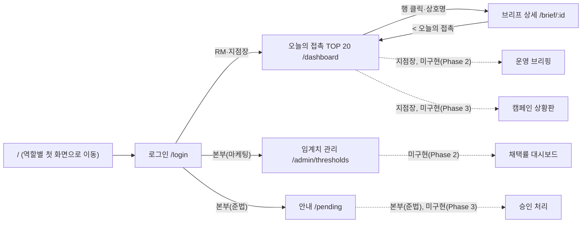

# C-MAKER 와이어프레임

- **버전**: v1.4.0
- **작성일**: 2026-08-26 (최종 수정: 2026-10-14)

---

## 변경 이력

| 버전 | 날짜 | 내용 |
|---|---|---|
| v1.0.0 | 2026-08-26 | 초안 작성 |
| v1.1.0 | 2026-09-08 | NH뱅크 인터넷뱅킹 UI 참고 캡처를 반영해 공통 레이아웃에 상단 유틸리티 바 추가, 오늘의 접촉 화면에 상태 필터 탭·업종 배지 추가. 컴포넌트 매핑은 `9-style-guide.md` v1.1.0을 따른다 |
| v1.1.1 | 2026-09-08 | 문서 정합성 점검 결과 반영: 접근 권한 표기를 `본부(마케팅)`/`본부(준법)`로 명확화(`1-domain-definition.md` v1.1.1 VAL-08과 정합), 캠페인 화면의 '준법대기' 라벨이 `CAMPAIGN.status = MANAGER_REVIEW`에 대응함을 명시. 하위 문서 인용 버전 정정 |
| v1.1.2 | 2026-09-08 | 큰글 모드(표시 개인화) 기능 제외 결정에 따라 §1 상단 유틸리티 바 목업과 서술에서 "큰글" 토글을 제거 |
| v1.2.0 | 2026-09-08 | 배치 지연/실패 대비 수동 재연동 기능 신설(REQ-17, UC-18) — §1 공통 레이아웃의 데이터 지연 배너에 지점장/본부(마케팅) 전용 "[ 수동 재연동 ]" 버튼 추가, 확인 다이얼로그·실행 중 상태·쿨다운 안내 서술 추가 |
| v1.3.0 | 2026-09-08 | `report/db-schema-decisions-review.md` 검토 결과 반영: 지점 등록/수정 화면(`BranchSetupPage`, UC-01·UC-02)을 MVP 스코프에서 제외해 옛 §3을 삭제하고 이후 화면 번호를 한 칸씩 당김(옛 §4~11 → §3~10). 하위 문서(`4-project-principle.md`, `9-style-guide.md`)의 장 번호 인용을 전부 갱신 |
| v1.4.0 | 2026-10-14 | 현재 프론트엔드 구현(`NH-Campaigner-UI-proposal.html` P0/P1 반영, NH Campaigner 공식 시그니처 적용)과 일치하도록 정정: §1 상단 유틸리티 바(시그니처·부제, 보조 링크 삭제)·사이드바 실제 노출 메뉴(미구현 Phase 2·3 메뉴 미렌더링, 본부(준법) 안내 화면 `/pending`), §2 로그인 실제 문구, §3 대시보드 실제 구성(아침 브리핑·데이터 기준 도장·오늘 기록·신호별 대상·기록 상태 탭·CRM 등록 파일·한 줄 명부 행·되돌리기 토스트, 점수 표시와 미구현 신호 예시 삭제), §4 브리프 실제 표시 항목, §6 임계치 관리(신호/운영 파라미터 구분·고정값 편집 불가), §9 화면 흐름을 `router.tsx` 라우트 기준으로 갱신. Phase 2·3 화면에 "미구현" 표기 |

---

## 0. 문서 목적 및 전제

본 문서는 `4-project-principle.md`(v1.5.0) 6장에 정의된 프론트엔드 페이지(`frontend/src/pages/`)의 화면 구조를 정의한다. 시각 스타일(컬러·타이포그래피·컴포넌트 톤)은 `9-style-guide.md`에서 다루며, 본 문서는 레이아웃과 정보 배치만 다룬다.

- `2-prd.md`(v1.4.0) 6장에 따라 **데스크톱 우선**(1280px 기준)으로 설계하고, 태블릿(768~1279px)까지 대응한다. 모바일 전용 레이아웃은 이 단계에서 정의하지 않는다(영업점 창구·사무 공간에서 데스크톱/태블릿으로 사용하는 것을 전제로 한다).
- 화면 접근 권한은 역할(RM/지점장/본부(마케팅)/본부(준법))에 따라 다르다(VAL-08). 아래 각 화면에 접근 가능한 역할을 명시한다.
- Phase 2·3 전용 화면(운영 브리핑, 캠페인, 채택률 대시보드)도 함께 정의하되, 실제 구현 시점은 `7-execution-plan.md`를 따른다. (v1.4.0) 현재 프론트엔드에는 이 화면들의 라우트·메뉴가 없다 — 각 절에 **미구현(Phase 2/3)** 으로 표기한다.
- (v1.1.0) 2026-09-08 제공된 NH뱅크 인터넷뱅킹 화면 캡처를 레이아웃 참고 자료로 반영한다: 최상단 유틸리티 바(사용자/세션/보조 링크) 분리, 상태 전환용 밑줄 탭, 카드 내 액션 버튼 가로 배치, 항목 앞 outline 배지. 스타일(색상·형태) 세부는 `9-style-guide.md` §5.7~5.8을 따른다. (v1.1.2) 참고 캡처의 "큰글" 접근성 토글은 C-MAKER 요구사항(REQ/UC)에 근거가 없어 반영하지 않는다.
- (v1.4.0) 화면 표시 서비스명은 **NH Campaigner**다(C-MAKER는 시스템·코드명, `index.html` `<title>`도 NH Campaigner). 루트 `NH-Campaigner-UI-proposal.html`의 P0/P1 제안(아침 브리핑, 데이터 기준 도장, 오늘 기록 패널, 신호별 대상 막대, 한 줄 명부 행, 브리프 근거·화법 분리 등)이 구현에 반영되어 있으며, 아래 목업은 그 구현 기준이다. 목업 안의 상호·수치·문구 일부는 설명용 예시다.

---

## 1. 공통 레이아웃

모든 인증 화면은 **상단 유틸리티 바 + 좌측 고정 사이드바 + 지점 헤더 + 콘텐츠 영역** 구조를 공유한다. 사이드바 메뉴는 역할에 따라 달라진다.

```
┌────────────────────────────────────────────────────────────────────┐ ← 상단 3px 주색(Human Blue) 선
│ [NH Campaigner 시그니처] │ 영업점 아웃바운드 캠페인 에이전트                │
│                              한서영 지점장 · 24:13 · 연장 · 로그아웃 │
├───────────────┬──────────────────────────────────────────────────┤
│               │ 지점명 강남중앙지점                    한서영 (지점장) │
│ ▣ 오늘의 접촉  ├──────────────────────────────────────────────────┤
│               │ ⚠ 일부 신호가 지연되었습니다(기준일 1일 전)           │  ← 대시보드 외 화면의 지연 배너
│               │   (기상청 1일 전)                    [ 수동 재연동 ]│  ← 지점장/본부(마케팅)만 버튼 렌더링
│               ├──────────────────────────────────────────────────┤
│               │                     콘텐츠 영역                     │
│               │                  (최대 폭 1120px)                   │
└───────────────┴──────────────────────────────────────────────────┘
```

- 최상단 유틸리티 바(`TopUtilityBar`, `9-style-guide.md` §5.8)는 화면 전환과 무관하게 항상 고정 노출된다.
  - 좌측: NH Campaigner 공식 시그니처(심볼+워드마크 이미지 `public/brand/nh-campaigner.svg`, `BrandSignature`) | 세로 구분선 | 부제 "영업점 아웃바운드 캠페인 에이전트". 1279px 이하에서는 구분선·부제를 숨긴다. 시그니처에 워드마크가 들어 있으므로 옆에 서비스명을 글자로 다시 쓰지 않는다.
  - 우측: **사용자명** + 역할 라벨 · 세션 남은 시간(카운트다운) · 연장(세션 연장 가능 계정만) · 로그아웃. 남은 시간이 5분 이하가 되면 타이머가 경고색 + `⏱`로 바뀌고, 0이 되면 자동 로그아웃 후 로그인 화면으로 이동한다.
  - (v1.4.0) 기존 목업의 "고객센터 · 도움말" 보조 링크 줄은 구현되지 않아 삭제했다.
- 그 아래는 좌측 사이드바 + [지점 헤더 + 콘텐츠 영역] 구조다. 지점 헤더 좌측은 "지점명 {지점명}"(지점 소속이 없는 본부 계정은 "본부"), 우측은 사용자명 + 역할 outline 배지다(드롭다운 없음).
- 사이드바 메뉴는 20px 아이콘 + 라벨이며, 1279px 이하에서는 64px 아이콘 전용 모드가 된다. `/brief/:id` 화면에서도 "오늘의 접촉" 메뉴가 활성으로 표시된다.

| 역할 | 현재 노출 메뉴(MVP, `utils/roles.ts`) | 로그인 후 첫 화면 | 미구현 메뉴(Phase 2·3 구현 시 추가 예정) |
|---|---|---|---|
| RM | 오늘의 접촉 | `/dashboard` | — |
| 지점장 | 오늘의 접촉 | `/dashboard` | 운영 브리핑(Phase 2), 캠페인(Phase 3) |
| 본부(마케팅) | 임계치 관리 | `/admin/thresholds` | 채택률 대시보드(Phase 2) |
| 본부(준법) | (메뉴 없음) | `/pending` 안내 화면 | 캠페인 승인 대기열(Phase 3) |

- 미구현 메뉴는 비활성 표시도 하지 않고 DOM에 렌더링하지 않는다(`9-style-guide.md` §5.6). 본부(준법) 계정은 사이드바가 비어 있고, 첫 화면 `/pending`(`PendingPage`)에 "본부(준법) 역할의 캠페인 승인 화면은 Phase 3에서 제공됩니다. 현재 단계(MVP)에서 이용할 수 있는 메뉴가 없습니다." 안내만 표시한다.
- 데이터 지연 안내(RULE-SENSE-04)는 화면에 따라 두 가지로 나타난다.
  - 오늘의 접촉 화면: 상단 배너 대신 아침 브리핑 아래 **데이터 기준 도장**(`DataFreshnessStamps`, §3)과 그 아래 한 줄 안내로 표시한다.
  - 그 외 화면(브리프 상세, 임계치 관리 등): 콘텐츠 영역 맨 위 경고 배너(`DataDelayBanner`)로 "⚠ {서버 안내 문구}"와 대체 데이터를 쓴 소스별 지연일("(기상청 1일 전)" 형식)을 표시한다.
  - 안내 문구는 서버가 상황별로 내려준다: "일부 신호가 지연되었습니다(기준일 N일 전).", "일부 데이터를 수집하지 못했습니다: {소스}.", "오늘 일간 배치가 실패했습니다. 일부 데이터가 최신이 아닐 수 있습니다.", "오늘 추천 명부가 생성되지 않았습니다.", "오늘 일간 배치가 아직 완료되지 않았습니다." 등. 지연이 없으면 배너·안내 줄 모두 나타나지 않는다.
- 안내 우측의 **[ 수동 재연동 ]** 버튼(`ManualBatchTrigger`, REQ-17·UC-18)은 지점장·본부(마케팅) 역할에만 렌더링된다(RM·본부(준법)에는 안내만 보이고 버튼은 DOM에 없음).
- 버튼 클릭 시 확인 다이얼로그(제목 "수동 재연동", "일간 배치를 지금 다시 실행할까요? 완료까지 수 분이 걸릴 수 있습니다.", [실행]) → 확인 시 요청 전송. 실행 중에는 버튼이 "재연동 중…"으로 비활성화되고 옆에 "예상 완료 {일시}"를 보여준다. 이미 실행 중인 배치가 있으면 "이미 실행 중인 배치가 있어 새로 실행하지 않았습니다."를 표시한다. 완료되면 "재연동이 완료되었습니다. …" 또는 "재연동이 실패했습니다: {사유}" 안내([닫기] 포함)를 띄우고 추천·브리프 데이터를 다시 불러온다(UC-18 인수 기준).
- 쿨다운(VAL-12, 기본 30분) 중에는 버튼이 비활성화되고 버튼 옆 보조 텍스트와 툴팁으로 "N분 후 다시 시도할 수 있습니다"를 보여준다.

---

## 2. 로그인 화면

**접근 권한**: 전체(비인증)

```
┌──────────────────────────────────────────────┐
│                                                │
│   [NH Campaigner 시그니처]   ← 심볼+워드마크(40px)│
│   영업점 아웃바운드 캠페인 에이전트              │
│   ┌ NH농협은행 AI Agent 챌린지 ┐                │
│                                                │
│   ┌────────────────────────────────────────┐  │
│   │ (세션 만료로 돌아온 경우)                  │  │
│   │ 세션이 만료되어 로그아웃되었습니다.          │  │
│   │ 다시 로그인해주세요.                       │  │
│   │                                          │  │
│   │ 아이디                                    │  │
│   │ [                                    ]   │  │
│   │ 비밀번호                                  │  │
│   │ [                                    ]   │  │
│   │ (로그인 실패 시 오류 메시지)               │  │
│   │                                          │  │
│   │ (             로그인              )      │  │
│   └────────────────────────────────────────┘  │
│   계정은 본부 운영 담당자가 발급합니다.          │
│                                                │
└──────────────────────────────────────────────┘
```

- 시그니처 이미지(alt "NH Campaigner")가 화면 제목(`h1`) 역할을 한다. 이미지를 불러오지 못하면 "NH Campaigner" 글자로 대체한다.
- 로그인 버튼(Primary pill)은 아이디·비밀번호가 모두 입력되어야 활성화되고, 요청 중에는 "로그인 중…"으로 바뀐다. 성공하면 역할별 첫 화면(§1 표)으로 이동한다.
- 가입 화면은 없다(계정은 운영자가 등록).

---

## 3. 오늘의 접촉 TOP 20 — `DashboardPage` (UC-06)

**접근 권한**: RM, 지점장 (기록 버튼·CRM 등록 파일은 RM만)

이 화면은 상단 지연 배너를 쓰지 않는다(§1). 위에서부터 **상단 밴드(아침 브리핑 | 오늘 기록 | 신호별 대상) → 안내 배너(조건부) → 명부 시트 → 투명성 문구** 순서다.

**(a) 상단 밴드**

```
┌──────────────────────────────────┬──────────────────────┬────────────────────────────┐
│ 10월 14일 수요일                  │ 오늘 기록             │ 신호별 대상                 │
│                                  │                      │ 오늘 명부를 만든 신호입니다. │
│ 오늘 만날 20곳을 선정했습니다      │ 3/ 20곳              │ 누르면 그 사업장만 봅니다.   │
│ 신규 개업 8곳이 먼저입니다.        │ [■■■□□□□□□□□□□□□□□□] │                            │
│ 오늘 감지된 이벤트 12건 외 3건     │ ■ 방문함 2  ■ 보류 1  │ 신규 개업      ████████  8 │
│                                  │ ■ 부적합 0  □ 기록 전 17│ 주변 상권 개업  ████      4 │
│ 데이터 기준 [▤ 지방행정인허가 10.13] │ ──────────────────── │ 기상특보       ███       3 │
│   [▤ ECOS 10.13] [▤ 기상청 10.13 지연]│ ● 어제 기록하지 않은 곳 3곳│ 기본 조건      ██        2 │
│ ● 일부 신호가 지연되었습니다(기준일 1일 전).│ 기록은 내일 명부에 반영됩니다.│ …                       │
│                    [ 수동 재연동 ] │                      │                            │
└──────────────────────────────────┴──────────────────────┴────────────────────────────┘
```

- **아침 브리핑**(좌): 날짜("10월 14일 수요일") → 헤드라인 "오늘 만날 N곳을 선정했습니다"(명부가 비어 있으면 "오늘의 접촉") → 둘째 줄 "{신호명} N곳이 먼저입니다."(1순위 추천의 대표 신호와 그 신호의 건수. 신호 묶음이 하나뿐이거나 맨 앞 묶음이 '기본 조건'이면 생략) → 절사된 이벤트가 있을 때만 "오늘 감지된 이벤트 N건 외 M건"(RULE-SENSE-02).
- **데이터 기준 도장**(`DataFreshnessStamps`): "데이터 기준" 라벨 뒤에 출처별 `[▤ 출처명 MM.DD]` 도장을 나열한다. 소스 장애로 이전 데이터를 쓴 출처에만 "지연" 라벨을 붙이고, 오늘 수집하지 못한 출처는 날짜 자리에 "미수집"을 쓴다. 공표 주기 때문에 기준일이 며칠 전인 것은 지연이 아니다. 도장 툴팁·스크린리더 문구로 "{출처} 기준일 YYYY-MM-DD(. 소스 장애로 이전 데이터를 사용했습니다.)"를 제공한다. 서버 안내 문구(§1)가 있으면 도장 아래 한 줄로 보여주고, 지점장에게는 그 줄에 [ 수동 재연동 ] 버튼을 둔다(UC-18).
- **오늘 기록**(`TodayRecordPanel`, 가운데): "기록한 수/ 전체 곳" 큰 숫자, 방문함·보류·부적합 비율 막대, 범례 4칸(방문함·보류·부적합·기록 전 건수). 어제 명부에 기록하지 않은 곳이 있으면 "● 어제 기록하지 않은 곳 N곳"을 붙인다(UC-09 예외 흐름). 하단 고정 문구 "기록은 내일 명부에 반영됩니다." 오늘 명부의 처리 현황일 뿐 개인 성과 지표가 아니므로 비율(%)·달성률로 표기하지 않는다(CLAUDE.md §0.7).
- **신호별 대상**(`SignalBarsPanel`, 우): 오늘 명부를 대표 신호(추천의 `signalType`)별로 묶어 "신호명 · 막대 · 건수"로 보여준다. 순위가 높은 추천의 신호가 위에 온다. 신호명은 `utils/signal.ts` 기준(신규 개업, 같은 업종 개업, 주변 상권 개업, 환율 변동, 유가 변동, 기상특보, 기온 급변 예보, 계절 전환 예보, 첫 영하 예보, 첫 폭염 예보)이며, 기여 신호 없이 선정된 추천은 "기본 조건", 매핑에 없는 신호는 "기타 신호"로 묶는다. 막대를 누르면 그 신호의 사업장만 명부에 보이고(아래 "~만 보는 중" 칩), 같은 막대를 다시 누르면 해제된다.
- 명부가 비어 있으면 오늘 기록·신호별 대상 패널을 그리지 않는다.
- 1279px 이하에서는 아침 브리핑이 한 줄을 차지하고 두 패널이 그 아래 2열로, 767px 이하에서는 1열로 쌓인다.

**(b) 안내 배너(조건부) + 명부 시트 + 하단**

```
  [ 오늘 명부의 65%가 상권 공통 사유만으로 선정되었습니다(기준 60% 초과). ]   ← 상권사유비율 초과 시(정보 배너)
┌──────────────────────────────────────────────────────────────────────────────────┐
│ 전체 20  기록 전 17  방문함 2  보류 1  부적합 0     (신규 개업만 보는 중 ×) [⤓ CRM 등록 파일 받기 ▾]│
│ ────                                                                               │
├──────────────────────────────────────────────────────────────────────────────────┤
│  1  ○○떡볶이      최근 인허가를 받은 신규 개업 사업장 …         [방문함][보류][부적합 ▾] │
│     떡볶이 전문    [▤ 지방행정인허가 10.12]                                           │
├──────────────────────────────────────────────────────────────────────────────────┤
│▌ 2  △△세탁소      …                                         [✓ 방문함][보류][부적합 ▾]│
│     세탁소         [▤ 소상공인상가정보 06.30]                                         │
├──────────────────────────────────────────────────────────────────────────────────┤
│  …(최대 20행, 탐색 슬롯 항목도 같은 행으로 표시)                                      │
└──────────────────────────────────────────────────────────────────────────────────┘
ⓘ 대상과 사유는 공공데이터를 기준으로 규칙이 정하고, 전화 화법은 AI가 작성합니다. 고객 개인정보는 다루지 않습니다.

                  ┌──────────────────────────────────────┐
                  │ △△세탁소 · 방문함 저장됨   되돌리기   × │   ← 기록 직후 화면 하단 토스트
                  └──────────────────────────────────────┘
```

- **안내 배너**(정보 톤, 조건부): 상권 공통 사유만으로 선정된 비율이 기준(`AREA_REASON_RATIO_LIMIT`)을 넘으면 "오늘 명부의 N%가 상권 공통 사유만으로 선정되었습니다(기준 M% 초과)."(RULE-TARGET-06). 오늘 명부가 비어 있는데 어제 미기록 건이 있으면 오늘 기록 패널 대신 "어제 명부에서 기록하지 않은 곳이 N곳 있습니다." 배너를 보여준다.
- **기록 상태 탭**: `전체 / 기록 전 / 방문함 / 보류 / 부적합` 밑줄 탭(`9-style-guide.md` §5.7)에 상태별 건수를 붙인다(명부가 비어 있으면 건수 생략). 탭 건수는 신호 필터와 무관하게 오늘 명부 전체 기준이다. 탭과 신호 필터는 함께(AND) 적용되며, 목록 순서(순위)는 바꾸지 않고 보기만 거른다 — 필터가 배제·재정렬 로직에 관여하지 않는다.
- **도구 영역**(탭 오른쪽): 신호 필터가 걸려 있으면 "{신호명}만 보는 중 ×" 칩(× = 필터 해제). RM에게만 **[ CRM 등록 파일 받기 ▾ ]** 버튼(Primary 사각)이 렌더링되며, 누르면 `CSV` / `Excel (XLSX)` 형식 메뉴가 열린다. 생성 중에는 "파일 생성 중…"으로 비활성화되고, 명부가 비어 있으면 비활성이다. 파일에는 오늘 명부 중 **'방문함'으로 기록하고 영업상태가 '정상'인 건만** 담긴다(UC-08, 서버 `export_rows`).
- **한 줄 명부 행**(`RecommendationCard`): `순위 숫자 | 상호명(굵게)·업종 | 선정 사유 1줄 + 출처 도장 | 기록 버튼` 4열 그리드다.
  - 업종은 원본 분류의 마지막 단계만 보여주고(`industryLeaf`, 예: '시설관리·임대·여행사·보조·여행사' → '여행사'), 전체 분류는 툴팁으로 제공한다. 업종은 배지가 아닌 상호명 아래 보조 글자다.
  - 선정 사유는 배치가 만든 요약 1줄이며 넘치면 말줄임(전체는 툴팁), 그 아래 대표 출처 도장 `[▤ 출처명 MM.DD]`를 붙인다.
  - **점수는 표시하지 않고 순위 숫자만** 둔다. 탐색 슬롯 여부(RULE-TARGET-04)와 행별 '어제 미기록' 배지도 표시하지 않는다(어제 미기록은 오늘 기록 패널의 수로만).
  - 행 왼쪽 3px 막대가 기록 상태를 나타낸다(방문함 그린·보류 옐로우·부적합 회색, 기록 전은 막대 없음). 부적합 행은 상호명·사유를 흐리게 표시한다.
  - 행을 클릭하거나 상호명 링크를 누르면 `BriefDetailPage`(4장)로 이동한다(키보드·보조기기는 상호명 링크로 이동). 기록 버튼 영역 클릭은 이동하지 않는다.
  - 1279px 이하에서는 사유가 상호명 아래로, 기록 버튼은 다음 줄로 내려간다.
- **기록 버튼**(`TagButtons`, RM만): `[방문함] [보류] [부적합 ▾]`. 클릭 1회로 저장하고(페이지 이동 없음, UC-09), 현재 상태 버튼은 상태색 채움 + `✓`로 표시한다. 같은 상태를 다시 누르면 아무 일도 하지 않는다. '부적합 ▾'는 "부적합 사유" 메뉴(이미 거래중 / 대상 아님 / 정보 오류 / 접촉 불가, VAL-06)를 열며 사유를 고르면 저장된다. 부적합으로 저장된 버튼은 "부적합 · {사유}"로 표시한다. 지점장에게는 버튼 대신 읽기 전용 상태 배지(기록 전 / 방문함 / 보류 / 부적합 · {사유})를 보여준다.
- **되돌리기 토스트**(`TagUndoToast`): 기록 직후 화면 하단 가운데에 "{상호명} · {상태} 저장됨 [되돌리기] ×"를 10초간 띄운다(UC-09 인수 기준 "저장 직후 되돌리기"). 저장 실패 시 같은 자리에 오류 문구를 띄운다.
- **빈 상태**: 명부 미생성 시 "오늘의 접촉 명부가 아직 생성되지 않았습니다. 일간 배치 완료 후 표시됩니다.", 필터 결과가 없으면 "이 조건에 맞는 사업장이 없습니다."
- **투명성 문구**(하단 고정): "대상과 사유는 공공데이터를 기준으로 규칙이 정하고, 전화 화법은 AI가 작성합니다. 고객 개인정보는 다루지 않습니다."

---

## 4. 상담 브리프 상세 — `BriefDetailPage` (UC-07)

**접근 권한**: RM, 지점장

```
 < 오늘의 접촉
┌──────────────────────────────────────────┐ ┌ 전화 화법 [AI 작성]          [⧉ 화법 복사] ┐
│ ○○떡볶이                                  │ │ 통화 전에 내용을 한 번 확인하세요.          │
│ 업종 떡볶이 전문  거리 지점에서 약 0.4km     │ │ 인사  "안녕하세요 ○○떡볶이 사장님, NH농협은행 │
│ 주소 서울특별시 …                          │ │       강남중앙지점에서 … 연락드렸습니다."   │
└──────────────────────────────────────────┘ │ 용건  "개업 초기에 필요하신 매출 정산 계좌   │
┌ 왜 지금 연락하나요 ─────────────────────────┐ │       개설이나 … 도와드리고자 합니다."     │
│ 공공데이터를 기준으로 규칙이 고른 근거입니다.   │ │ 약속  "편하신 시간에 담당 직원이 잠시      │
│ ┃ 핵심 근거                                 │ │       찾아뵙고 … 괜찮을까요?"             │
│ ┃ 2026-10-10에 인허가를 받은 신규 개업        │ │ ┌ 통화 안내 (고정 문구) ─────────────┐ │
│ ┃ 사업장입니다. 개업 초기에는 주거래 은행과    │ │ │ 통화 시작 전                        │ │
│ ┃ 매출 정산 계좌를 새로 정하는 경우가 많아 …   │ │ │ 은행·지점명(NH농협은행 강남중앙지점),  │ │
│ ┃ [▤ 지방행정인허가 10.13]                    │ │ │ 직원 이름(김도윤), 연락 목적, 안내할    │ │
│ 보조 근거                                   │ │ │ 상품 종류를 먼저 밝힙니다.            │ │
│ ─ 지점에서 약 0.4km 거리에서 영업 중인 …      │ │ │ 통화 마칠 때                        │ │
│                   [▤ 소상공인상가정보 06.30] │ │ │ "연락을 원하지 않으시면 말씀해 주세요. │ │
│ ─────────────────────────────────────────  │ │ │  다시 연락드리지 않겠습니다."          │ │
│ 추천상품                                    │ │ └──────────────────────────────────┘ │
│ {상품명} · {상품명}                          │ └──────────────────────────────────────┘
│ 선정 신호에 맞춰 규칙으로 정한 상품입니다.      │ ┌ 접촉 결과 ──────────────────────────┐
│ AI가 고르지 않습니다.                        │ │ [방문함] [보류] [부적합 ▾]            │
└──────────────────────────────────────────┘ │ ──────────────────────────────────── │
┌ 날씨 참고 ─────────────────────── (있을 때만) ┐ │ 기록은 내일 명부에 반영됩니다.          │
│ 선정 사유가 아닌 참고 정보입니다. 방문 일정을    │ │ 연락을 원하지 않는 고객은 '부적합 →     │
│ 정할 때 참고하세요.                          │ │ 접촉 불가'로 기록하면 명부에서 영구     │
│ {비·눈 예보 문구}                            │ │ 제외됩니다. 방문은 오전 8시~오후 9시에만 │
└──────────────────────────────────────────┘ │ 합니다.                              │
┌ 방문 전 확인 ──────────────────────────────┐ └──────────────────────────────────────┘
│ ☐ 사업자등록증 확인      ☐ 현재 거래 은행 확인 │      ↑ 우측 열(372px)은 스크롤 시 고정
│ ☐ 카드단말기 사용 현황 확인                   │
└──────────────────────────────────────────┘
ⓘ 대상과 사유는 공공데이터를 기준으로 규칙이 정하고, 전화 화법은 AI가 작성합니다. 고객 개인정보는 다루지 않습니다.
```

- 레이아웃: 1280px 이상은 좌측 `읽을 것`(사업장·근거·날씨·체크리스트) | 우측 `통화와 기록`(전화 화법·접촉 결과, 372px, 스크롤 시 고정) 2단, 1279px 이하는 1단. 이 화면에는 §1의 데이터 지연 배너가 콘텐츠 맨 위에 나타날 수 있다.
- **사업장 카드**: 상호명, `업종`(마지막 분류 단계만, 전체는 툴팁), `거리`("지점에서 약 N.Nkm"), `주소`(있을 때만).
- **왜 지금 연락하나요**: 첫 사실 문장을 **핵심 근거**(강조 블록), 나머지를 **보조 근거** 목록으로 나눈다. 모든 사실 문장에 출처 도장 `[▤ 출처명 MM.DD]`(`SourceStamp`)가 붙는다(RULE-BRIEF-01). 사실 문장이 아직 없으면 "선정 사유를 생성하는 중입니다."
- 선정 사유는 "관측된 사실(수치·기준일) + 영업 관점의 의미(왜 지금 연락할 만한지)"로 쓴다. 의미 문구는 신호 종류별 고정 문구다(`fact_builder.py`).
- **추천상품**(있을 때만): 같은 카드 하단에 상품명을 ` · `로 이어 쓰고 "선정 신호에 맞춰 규칙으로 정한 상품입니다. AI가 고르지 않습니다."를 붙인다.
- **날씨 참고**(있을 때만): 선정 사유와 분리된 별도 카드. "선정 사유가 아닌 참고 정보입니다. 방문 일정을 정할 때 참고하세요."
- **방문 전 확인**(체크리스트가 있을 때만): 체크박스 2열(1279px 이하 1열). 체크 상태는 화면 표시만 하고 저장하지 않는다.
- **전화 화법**: 제목 옆에 생성 방식 배지 — "AI 작성"(LLM) 또는 "기본 화법"(템플릿, 이때 안내 "문장 생성 서비스가 연결되지 않아 기본 화법을 보여줍니다."). 화법은 ① 인사·연락 사유 ② 연락 목적(사장님 입장에서 지점이 도울 일) ③ 방문·상담 요청의 3문장 구조이고, 3문장이 모두 있을 때만 단계명 `인사 / 용건 / 약속`을 붙인다(일부가 검증에서 빠지면 1·2… 번호). [화법 복사]로 클립보드에 복사한다. 연락 사유·목적은 가장 기여도 높은 신호로 정한다.
- 근거 없는 문장은 이미 생성 단계에서 제거되어 이 화면에 나타나지 않는다(RULE-BRIEF-02). 화법이 모두 차단된 경우 "근거가 확인되지 않은 문장이 검증 단계에서 차단되어 선정 사유만 표시합니다."를 보여준다.
- **통화 안내(고정 문구)**: AI 화법과 별개로 규칙이 붙이는 안내다. "통화 시작 전"에는 로그인 직원의 지점명·이름을 넣은 고지 항목, "통화 마칠 때"에는 연락 거부 안내 문장을 보여준다(문구 확정 전 준법감시 확인 필요 — 코드 주석).
- **접촉 결과**: `DashboardPage`와 같은 기록 버튼(`TagButtons`, RM만, 지점장은 읽기 전용 배지)과 "기록은 내일 명부에 반영됩니다.", 연락 거부 고객 처리·방문 시간 안내 문구. 기록 후 §3과 같은 되돌리기 토스트가 뜬다.
- 하단에 §3과 같은 투명성 문구를 둔다.

---

## 5. 운영 브리핑 — `OperationsPage` (UC-11, Phase 2)

> **미구현(Phase 2)**: 현재 라우트·사이드바 메뉴가 없다. 아래는 구현 시 목표 구조다.

**접근 권한**: 지점장

```
┌───────────────┬──────────────────────────────────────────────────┐
│ (사이드바)     │  운영 브리핑 (2026-08-26, 추석 D-5)                │
│               ├──────────────────────────────────────────────────┤
│               │  ┌───────────────┐┌───────────────┐┌────────────┐│
│               │  │ 현금 출납 수요 ││ ATM 충전 수요  ││ 외화 재고   ││
│               │  │  ▲ 120~150%   ││  ▲ 110~130%   ││  ▲ 105~115% ││
│               │  │  근거: 명절·   ││  근거: 명절     ││ 근거: 환율   ││
│               │  │  기상특보      ││                ││ 급등        ││
│               │  └───────────────┘└───────────────┘└────────────┘│
│               │                                                    │
│               │  오늘의 안내 상품 우선순위                          │
│               │  1. 외화예금 (근거: 환율 1.2% 상승 [ECOS·8/26])    │
│               │     └ 공개 상품설명서 인용 보기 ▾                  │
│               │  2. ...                                            │
└───────────────┴──────────────────────────────────────────────────┘
```

- 수요 예측은 항상 구간(예: 120~150%)과 근거 신호를 함께 표시한다.
- 인용 근거가 없는 상품은 우선순위 목록에 나타나지 않는다.

---

## 6. 임계치·가중치 관리 — `AdminThresholdPage` (UC-15)

**접근 권한**: 본부(마케팅) (로그인 후 첫 화면 `/admin/thresholds`)

```
┌───────────────┬────────────────────────────────────────────────────────────────┐
│ (사이드바)     │  임계치 관리                                                     │
│ ▣ 임계치 관리  │  변경 즉시 저장되며 다음 일간 배치부터 적용됩니다. 모든 변경은       │
│               │  수정 계정·일시·이전값과 함께 이력으로 남습니다.                    │
│               │                                                                  │
│               │  신호 승격 임계치  10개                                           │
│               │  ┌────────────────────┬──────────────────────┬──────────┬──────┐ │
│               │  │ 항목                │ 현재 임계치            │ 최근 수정  │      │ │
│               │  ├────────────────────┼──────────────────────┼──────────┼──────┤ │
│               │  │ 신규 개업(사업체)    │ ┆발효 즉시 (고정)┆      │ 일시      │변경   │ │
│               │  │ (설명)              │                      │ 초기값    │이력 ▾ │ │
│               │  │ 신규 개업(상권)      │ [    3] 건/일 [저장]   │ 일시      │변경   │ │
│               │  │ (설명)              │                      │ 최유나    │이력 ▴ │ │
│               │  │  └ 2026-10-02 09:12  최유나  3건/일 → 5건/일  (펼친 이력 행)   │ │
│               │  │ 환율 일변동          │ [  1.0] %     [저장]   │ …        │ …    │ │
│               │  │ 기상특보             │ ┆발효 즉시 (고정)┆      │ …        │ …    │ │
│               │  │ …                   │                      │          │      │ │
│               │  └────────────────────┴──────────────────────┴──────────┴──────┘ │
│               │                                                                  │
│               │  운영 파라미터  5개                                               │
│               │  (같은 표 구조 — 이벤트 병합 쿨다운, 지점당 일일 이벤트 상한,         │
│               │   신호별 명부 상한, 최근 접촉 쿨다운, 상권사유비율 경고 기준)        │
└───────────────┴────────────────────────────────────────────────────────────────┘
```

- 화면은 임계치 항목을 `category`로 나눈 두 표다: **신호 승격 임계치**(`SIGNAL`)와 **운영 파라미터**(`SYSTEM`). 표 제목 옆에 항목 수를 붙인다. 항목명·설명·단위는 서버 값(`threshold_config.label/description/unit`)을 그대로 보여준다(위 항목명은 초기 데이터 기준).
- 표는 `항목(이름 + 설명) | 현재 임계치 | 최근 수정(일시 + 수정자, 수정 이력이 없으면 "초기값") | 변경 이력 ▾` 4열이다.
- **고정값 항목**(`is_fixed`, 예: 신규 개업(사업체)·기상특보·첫 영하 예보·첫 폭염 예보)은 입력창·저장 버튼 없이 점선 배지 "발효 즉시 (고정)"만 보여주며 편집할 수 없다. 변경 이력 조회는 가능하다.
- 편집 가능한 항목은 숫자 입력(우측 정렬) + 단위 + [저장](Primary 사각). 값이 바뀌었을 때만 저장 버튼이 활성화되고, 요청 중에는 "저장 중…"이다.
- 저장 시 즉시 검증(VAL-05)한다 — "값을 입력해주세요." / "숫자를 입력해주세요." / "0 이상이어야 합니다." / "정수만 입력할 수 있습니다."(정수 전용 항목) / "최소 N{단위}" / "최대 N{단위}". 오류는 입력창 아래에 표시하고, 서버도 같은 규칙으로 다시 검증한다. 성공 시 "저장되었습니다. 다음 배치부터 적용됩니다."
- [변경 이력 ▾]를 누르면 해당 행 바로 아래에 이력 행이 펼쳐져 `일시 · 수정자 · 이전값 → 이후값`을 나열한다(REQ-15). 이력이 없으면 "변경 이력이 없습니다(초기값)."
- 가중치(신호×업종) 편집 UI는 이 화면에 없다.

---

## 7. 채택률 대시보드 — `AdoptionDashboardPage` (UC-16, Phase 2)

> **미구현(Phase 2)**: 현재 라우트·사이드바 메뉴가 없다. 아래는 구현 시 목표 구조다.

**접근 권한**: 본부(마케팅)

```
┌───────────────┬──────────────────────────────────────────────────┐
│ (사이드바)     │  채택률 대시보드                                   │
│               ├──────────────────────────────────────────────────┤
│               │  ┌─────────────┐┌─────────────┐┌─────────────┐   │
│               │  │ 전체 채택률  ││ 전체 태깅률  ││ 미태깅 잔량  │   │
│               │  │    34%      ││    76%      ││   142건     │   │
│               │  └─────────────┘└─────────────┘└─────────────┘   │
│               │                                                    │
│               │  신호별 × 업종별 채택률 (표)                        │
│               │  ───────────────────────────────────────────────  │
│               │  신규개업 × 요식업     42%  (표본 118, 가중치 1.3) │
│               │  기상특보 × 소매업     19%  (표본 22, 표본부족)     │
│               │  ...                                              │
└───────────────┴──────────────────────────────────────────────────┘
```

- 표본 부족(n<30) 조합은 "표본부족" 배지로 구분하고 가중치가 갱신되지 않았음을 표시한다(RULE-LEARN-03).

---

## 8. 캠페인 상황판 및 검토 — `CampaignBoardPage` (UC-12~14, Phase 3)

> **미구현(Phase 3)**: 현재 라우트·사이드바 메뉴가 없다. 본부(준법) 계정은 대신 `/pending` 안내 화면(§1)으로 들어간다. 아래는 구현 시 목표 구조다.

**접근 권한**: 지점장(검토), 본부(준법)(승인), 본부(마케팅)(상황판 조회)

```
┌───────────────┬──────────────────────────────────────────────────┐
│ (사이드바)     │  캠페인 상황판                                     │
│               ├──────────────────────────────────────────────────┤
│               │  트리거: 폭염특보 3일 연속           상태: 준법대기│
│               │  ─────────────────────────────────────────────── │
│               │  초안 미리보기                                     │
│               │  "폭염이 지속되고 있습니다. NH농협은행 포용금융 상담..."│
│               │  ✓ 광고성 정보 표기   ✓ 수신거부 문구                │
│               │                                                    │
│               │  [ 지점장 검토 완료 ]   [ 준법 승인 ]   [ 반려 ]    │
│               │                                                    │
│               │  진행 이력: 초안생성(8/24) → 지점장검토(8/25) →    │
│               │             준법승인 대기중                        │
└───────────────┴──────────────────────────────────────────────────┘
```

- 광고성 정보 표기·수신거부 문구 체크가 모두 되어 있지 않으면 '지점장 검토 완료' 버튼이 비활성화된다(VAL-07).
- 화면의 '준법대기'/'준법승인 대기중' 라벨은 `CAMPAIGN.status = MANAGER_REVIEW`(`1-domain-definition.md` v1.1.2, `6-erd.md` v1.1.1)에 대응한다.
- 준법 승인 버튼은 `USER.role = HQ_COMPLIANCE`(본부(준법)) 계정에게만 노출되며, 승인 시 상태가 `APPROVED`를 거쳐 즉시 '이관완료'(`HANDED_OFF`)로 바뀐다(RULE-CAMPAIGN-01). `HQ_MARKETING`(본부(마케팅)) 계정에는 이 버튼이 노출되지 않는다.

---

## 9. 화면 흐름도

실선은 `frontend/src/router.tsx`에 있는 실제 라우트, 점선은 미구현(Phase 2/3) 화면이다.



- 미인증 상태로 보호 경로에 들어가면 `/login`으로, 권한 없는 역할이 다른 역할의 경로에 들어가면 자기 역할의 첫 화면으로 이동한다. 정의되지 않은 경로도 역할별 첫 화면으로 보낸다. 화면 가드는 UX용이며 최종 권한 검증은 API 서버가 한다.
- 이미 로그인한 사용자가 `/login`에 오면 역할별 첫 화면으로 이동한다. 세션이 만료되면 자동 로그아웃 후 `/login`에 만료 안내를 띄운다(§2).
- 기록(태깅)은 대시보드·브리프 상세 어디서든 페이지 이동 없이 저장된다. 브리프 상세에서 대시보드로는 상단 "< 오늘의 접촉" 링크나 사이드바 메뉴로 돌아간다.

---

## 10. 참고 문서

- `1-domain-definition.md` (v1.4.0): UC-01~18 인수 기준(UC-01·UC-02는 MVP 스코프 제외 — 화면 없음)
- `2-prd.md` (v1.4.0): 2장 목표 사용자, 6장 플랫폼/UI
- `3-user-scenario.md` (v1.4.0): SC-01~09 (화면 간 이동 흐름의 근거)
- `4-project-principle.md` (v1.5.0): 6장 프론트엔드 페이지 목록
- `report/CHANGE-REQUEST_v1.md`와는 별개로, 배치 지연 대비 수동 재연동 버튼(REQ-17, UC-18)은 사용자 요청으로 신설
- `report/db-schema-decisions-review.md`: 지점 등록/수정 화면(옛 §3, `BranchSetupPage`) 제외 결정 근거
- `9-style-guide.md` (v1.5.0): 본 문서의 레이아웃 요소에 대응하는 컴포넌트 스타일(색상·형태)
- NH뱅크 인터넷뱅킹 화면 캡처 (사용자 제공, 2026-09-08): §1 상단 유틸리티 바, §3 상태 필터 탭의 레이아웃 참고 자료
- `NH-Campaigner-UI-proposal.html` (저장소 루트): §1~§4 현재 구현(아침 브리핑, 데이터 기준 도장, 오늘 기록, 신호별 대상, 한 줄 명부 행, 브리프 근거·화법 배치, 공식 시그니처)의 근거 제안서
- `frontend/src/router.tsx`, `frontend/src/utils/roles.ts`: §1 노출 메뉴·§9 화면 흐름의 기준 코드
